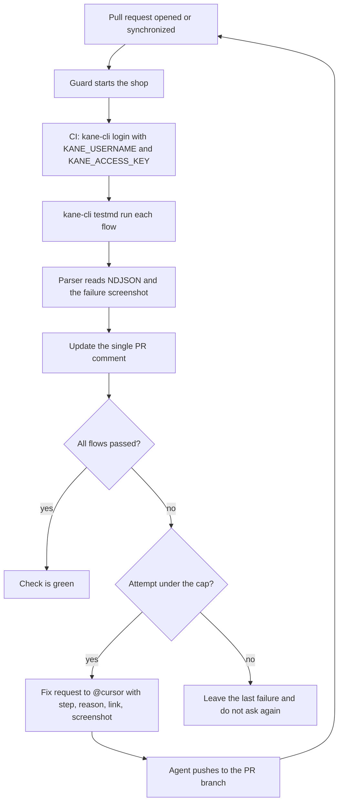

# Kane PR Guard

Every pull request starts the Northwind Supply sample shop, runs four
plain-English [Kane CLI](https://github.com/LambdaTest/kane-cli) flows
against it, and posts one comment with the result. A failure becomes a
fix request for the coding agent. The agent's push hits `synchronize`,
the guard runs again, and the same comment is updated. The loop stops
after 3 attempts (change it with `KANE_MAX_ATTEMPTS`).

Kane CLI 0.10.4 does not produce a video. The comment shows the Test
Manager run link, the failing step and reason, and the failure screenshot
extracted from the evidence pack.



## Install

Requires Node.js 18 or newer. Real Kane runs also need Google Chrome and
a TestMu AI account. The guard uses the `kane-cli` binary when it is on
`PATH`. If the binary is missing, `npm run guard` uses an HTTP mock so
you can still see the report. Set `KANE_RUNNER=kane` in CI so a missing
binary fails the job instead of pretending Kane ran.

1. Install the shop and the guard:

   ```bash
   npm install
   ```

2. Install Kane CLI and log in (skip this only if you want the mock):

   ```bash
   npm install -g @testmuai/kane-cli
   export PATH="$(npm prefix -g)/bin:$PATH"
   kane-cli login
   ```

3. Confirm the binary:

   ```bash
   kane-cli --version
   ```

## Run the shop

```bash
npm start
```

The app listens on port **3000**. Override it with `PORT`. Open
[http://localhost:3000](http://localhost:3000).

Seeded user, matching the flows:

| Field | Value |
| --- | --- |
| Email | `test@example.com` |
| Password | `password123` |
| Wrong password | `wrong-password-xyz` |

Shipping values the checkout flow types: name `Test User`, address
`123 Test Street`, city `Testville`, postal code `12345`, email
`test@example.com`, phone `555-0100`.

Promo code `SAVE10` (any letter case) takes 10% off the cart subtotal.
Enter it on the cart page and press Apply. The discount is rounded
half-up to the cent and does not stack if the code is applied again.
Any other code shows "Invalid promo code." and leaves the current total
in place. Checkout and the order confirmation show the subtotal, the
discount, and the total due.

## Run the guard locally

The guard starts the shop if nothing is already healthy at `BASE_URL`,
runs the flows, prints the comment, and writes `kane-report.json` plus
`kane-report.md`.

```bash
export PATH="$(npm prefix -g)/bin:$PATH"
export BASE_URL="${BASE_URL:-http://127.0.0.1:3000}"
npm run guard
```

Mock, when Kane CLI is not installed:

```bash
KANE_RUNNER=mock npm run guard
```

Run one flow the way CI does:

```bash
kane-cli testmd run kane-flows/login_test.md \
  --agent --headless \
  --url "$BASE_URL" \
  --override-start-url "$BASE_URL" \
  --on-lock-conflict wait \
  --timeout 180
```

Or the whole suite, which writes `kane-flows/results/combined.json`:

```bash
BASE_URL=http://127.0.0.1:3000 kane-flows/run-all.sh
```

Parse a saved NDJSON stream:

```bash
node guard/parse-results.mjs --markdown results/login/events.ndjson
```

## Demo flows

| File | What it checks |
| --- | --- |
| `kane-flows/login_test.md` | Wrong password shows an error, then the seeded user lands on the dashboard |
| `kane-flows/add-to-cart_test.md` | After sign-in, two items make the cart badge show 2 |
| `kane-flows/checkout_test.md` | Shipping form, place order, confirmation with an order number |
| `kane-flows/empty-cart-guard_test.md` | Empty cart blocks checkout and does not place an order |
| `kane-flows/promo-code_test.md` | `BOGUS` is rejected, `SAVE10` takes 10% off, confirmation matches checkout |
| `kane-flows/promo-edge-cases_test.md` | Lowercase `save10` is accepted, a second apply does not stack, removing an item recalculates |
| `kane-flows/exploratory-cart_test.md` | Spaces, reload, quantity change, and a new cart after emptying must not keep a hidden promo |
| `kane-flows/helpers/login.md` | Shared sign-in imported by the cart and checkout flows. Not an entry point |

The guard runs every `kane-flows/*_test.md` file. Helpers under
`kane-flows/helpers/` are imports, not entry points. `npm test` covers
the shop, the NDJSON parser, the comment body, the attempt cap, the
per-flow early exit, and a local mock run of those flows.

## Pull request loop

`.github/workflows/kane-pr-guard.yml` runs on `pull_request` `opened` and
`synchronize`. It installs Chrome and `@testmuai/kane-cli`, puts the
global npm bin on `PATH`, logs in, and runs `npm run guard`.

The guard posts one comment, found by the marker `kane-pr-guard-result`,
and updates that comment on later runs. The visible body is the reference
parser's: status, failing step, reason, Test Manager link, screenshot
file name. Kane CLI 0.10.4 has no video field. The JPEG extracted from
the evidence pack is uploaded with the job artifacts (`results/` and
`.testmuai/evidence/`), because the GitHub issue-comment API has no
binary attachment field.

`test_md_done` is the end of a flow. Run 43419883242 wrote that event for
`login_test.md` (`overall_status: passed`, with a `share_url`) and then
`kane-cli` never exited, so the next flow never started and Actions
cancelled the job about 27 minutes later. The guard now reads that event,
keeps the result, sends SIGTERM, then SIGKILL a few seconds later, and
moves on. A per-flow wall clock (`KANE_FLOW_WALL_SECS`, default 10
minutes) records a timeout instead of waiting. The job `timeout-minutes`
is 80. If Actions still cancels the job, `guard-finished` fails, so a
cancellation is not a green check.

On a failure before the attempt cap, the guard also writes
`kane-fix-request.md` and posts or updates one fix comment that mentions
the coding agent. The default mention is `@cursor`. The comment includes
the failing flow, the flow file as the expected behavior, the actual
failing step and reason, the run link, and the screenshot path.

| Variable | Default | Role |
| --- | --- | --- |
| `KANE_MAX_ATTEMPTS` | `3` | Guard runs before it stops asking for a fix. A repository variable overrides CI. |
| `KANE_FIX_AGENT` | `@cursor` | Mention in the fix comment. A repository variable overrides CI. |
| `KANE_FIX_HANDOFF` | `comment` | `comment`, `file`, `none`, or a module path that exports `handoff({ body, report })`. |
| `KANE_RUNNER` | `kane` if the binary exists, otherwise `mock` | CI sets `kane`. |
| `TIMEOUT_SECS` | `180` | Passed to Kane as `--timeout`. This does not kill a stuck `kane-cli`. |
| `KANE_FLOW_WALL_SECS` | `600` | Per-flow wall clock. On expiry the flow is a timeout and the next one starts. |
| `BASE_URL` | `http://127.0.0.1:3000` | `--url` and `--override-start-url`. |

A passing re-run replaces the fix comment with a short note that does
not mention the agent again. Assertion failures are also appended to
`BUG_LOG.md`.

## Secrets

Add these in the repository under Settings → Secrets and variables →
Actions. Do not commit them and do not echo them.

| Secret | Needed for | Status |
| --- | --- | --- |
| `KANE_USERNAME` | `kane-cli login` on the runner | Set. Run 43419883242 logged in (`kane-cli login ok`, Authenticated, Token valid) at 11:48:18Z. |
| `KANE_ACCESS_KEY` | `kane-cli login` on the runner | Set. Same run; the value is masked in the log. |
| `KANE_FIX_TOKEN` | Posting the `@cursor` fix comment as a GitHub user | Add this for the agent loop. A fine-grained or classic PAT that can create and update pull request comments (`pull-requests: write` on this repo). |

`GITHUB_TOKEN` is provided by Actions. The workflow grants
`pull-requests: write`, and the guard uses it for the result comment.
A local login (`kane-cli login`) stores a profile under
`~/.testmuai/kaneai/` and does not need the Kane secrets.

On GitHub Actions, if `KANE_RUNNER=kane` and either Kane secret is missing,
the guard exits 2 before starting `kane-cli`. That path is a backstop.
The 13 Nov hang was not a missing secret.

### Why the fix comment needs `KANE_FIX_TOKEN`

Cursor staff have said this is intentional, not a bug: comments from bots
and GitHub Apps, including `github-actions[bot]` using the default
`GITHUB_TOKEN`, are filtered out of PR comment triggers before the
trigger settings are checked. A comment that mentions `@cursor` and is
posted by Actions does not start a Cursor agent. Sources, all on
forum.cursor.com:

- [Github Actions commenting @cursor not being detected](https://forum.cursor.com/t/github-actions-commenting-cursor-not-being-detected/148135) (staff, 6 Jan 2026: use a PAT so the comment is posted by a real user)
- [Automations — reacting to bot PR comments](https://forum.cursor.com/t/automations-reacting-to-bot-pr-comments/159297) (staff, 1 May 2026: bots are filtered to avoid chained triggers; a PAT is the workaround when you control the workflow)
- [Do Issue comment automations accept github-actions[bot]?](https://forum.cursor.com/t/do-issue-comment-automations-accept-github-actions-bot-when-set-to-anyone/170940) (staff, 8 Sep 2026: the same filter applies even when the trigger is set to Anyone)

What I could not confirm: there is no setting in this repository that I
can read which proves an automation named for this repo is subscribed to
PR comments. The PAT makes the comment eligible. Someone with access to
Cursor still has to have a PR-comment automation (or the GitHub `@cursor`
mention) watching this repo. I also could not list the Actions secret
names (`gh secret list` returned 403), so "set" above is from the run
log, not from the secret store API.

When `KANE_FIX_TOKEN` is set, only the fix-request comment uses it. The
result comment stays on `GITHUB_TOKEN`. When it is unset, the fix
request still posts as `github-actions[bot]` and names that limitation
in the job log.

Optional repository variables: `KANE_MAX_ATTEMPTS`, `KANE_FIX_AGENT`.

## Kane CLI contract

Confirmed against the verifier's Kane CLI 0.10.4 notes and the public
docs at <https://www.testmuai.com/docs/kane-cli-cli-reference>:

- Package: `@testmuai/kane-cli`. Command: `kane-cli`. Node 18+.
- `kane-cli testmd run <file>_test.md` is the command for a committed flow. `kane-cli run` is one-shot and rejects `.md` paths.
- Always pass `--agent` (NDJSON on stdout, one JSON object per line, `v: 1`) and `--headless` (Chrome has no window in CI).
- Pass/fail for a file is `test_md_done.overall_status`. Step `run_end` events are not the file result. The shareable link is `test_md_done.share_url`, else `run_end.test_url`.
- Exit codes: `0` passed, `1` failed, `2` error (the run may have no completion event), `3` timeout or cancel. The guard treats 2 and 3 as `error` and `timeout`, not as an assertion failure.
- Evidence packs are zip files ending in `.evidence`. The path is printed on stderr: ``evidence: view locally with `kane-cli evidence serve <path>` ``. The failure screenshot is the `screenshot.jpg` next to the `failure.yaml` entry inside that zip. Packs contain screenshots and logs, not video.
- CI auth is one `kane-cli login --username "$KANE_USERNAME" --access-key "$KANE_ACCESS_KEY"` at the start of the job, then `kane-cli whoami`. Per-run `--username` / `--access-key` also exist. This repo uses the login command.
- `output-<stem>/` next to a flow is the replay cache. Commit it after the first successful authoring run so later CI can replay. Do not commit `.testmuai/evidence/`.

Not confirmed from the public flag reference fetched on 13 Nov 2026:
`--override-start-url` is not listed there (`--url` is). The verifier's
working 0.10.4 command passes both, and this guard does too. If a future
CLI rejects the flag, the run exits 2 and the comment shows `error`.
